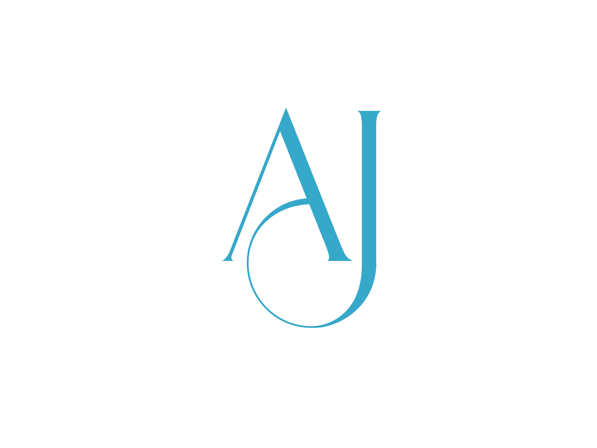

<a name="readme-top"></a>

<div align="center">
  
  <br/>

  <h1><b>Ajrass' Portfolio</b></h1>
</div>

# 📗 Table of Contents

- [📖 About the Project](#about-project)
  - [🛠 Built With](#built-with)
    - [Tech Stack](#tech-stack)
    - [Key Features](#key-features)
  - [🚀 Live Demo](#live-demo)
- [💻 Getting Started](#getting-started)
  - [Prerequisites](#prerequisites)
  - [Setup](#setup)
  - [Install](#install)
  - [Usage](#usage)
  - [Run Tests](#run-tests)
  - [Deployment](#deployment)
- [👥 Author](#author)
- [🔭 Future Features](#future-features)
- [🤝 Contributing](#contributing)
- [⭐️ Show your support](#support)
- [📝 License](#license)

---

# 📖 Ajrass' Portfolio <a name="about-project"></a>

**Ajrass' Portfolio** is a modern, responsive personal portfolio website. It showcases my recent projects, technologies, and expertise, aiming to provide a professional platform for prospective clients or employers. The portfolio includes an interactive 3D project display, smooth navigation with a floating navbar, and user feedback integration with Sentry. Built with **Next.js**, **Tailwind CSS**, and **Framer Motion**, the site delivers an engaging and user-friendly experience.

---

## 🛠 Built With <a name="built-with"></a>

### Tech Stack <a name="tech-stack"></a>

<details>
  <summary>Client</summary>
  <ul>
    <li><a href="https://nextjs.org/">Next.js</a></li>
    <li><a href="https://reactjs.org/">React.js</a></li>
  </ul>
</details>

<details>
  <summary>Styling</summary>
  <ul>
    <li><a href="https://tailwindcss.com/">Tailwind CSS</a></li>
    <li><a href="https://www.framer.com/motion/">Framer Motion</a></li>
  </ul>
</details>

<details>
  <summary>Monitoring & Feedback</summary>
  <ul>
    <li><a href="https://sentry.io/">Sentry</a></li>
  </ul>
</details>

---

### Key Features <a name="key-features"></a>

- **3D Project Showcase**: Projects are presented with dynamic 3D hover effects, creating an interactive experience with Framer Motion.
- **Floating Navbar**: A smooth, floating navigation bar makes it easy to scroll between sections and improves user experience.
- **Sentry User Feedback**: Integrated error tracking and user feedback collection using Sentry for monitoring.
- **Responsive Design**: Ensures seamless display on various screen sizes, providing a consistent experience across devices.

<p align="right">(<a href="#readme-top">back to top</a>)</p>

---

## 🚀 Live Demo <a name="live-demo"></a>

- [Live Demo Link](https://google.com)

<p align="right">(<a href="#readme-top">back to top</a>)</p>

---

## 💻 Getting Started <a name="getting-started"></a>

To get a local copy up and running, follow these steps:

### Prerequisites

Make sure you have the following installed on your machine:

- **Node.js** (version 16.x or later)
- **npm** or **yarn**
- **Git**
- **Code Editor** (e.g., Visual Studio Code)
- **Sentry Account** (optional, for error tracking)

### Setup

1. Clone this repository to your desired folder:

```bash
git clone https://github.com/tajemouti/next_portfolio.git
```

2. Navigate to the project directory:

```bash
cd next_portfolio
```

### Install

Install the dependencies with:

```bash
npm install
```

### Usage

To run the development server, execute the following command:

```bash
npm run dev
```

### Run Tests

If you want to run the available tests:

```bash
npm run test
```

### Deployment

You can deploy this project using [Vercel](https://vercel.com/) or any platform of your choice:

1. Link your GitHub repository with the deployment platform.
2. Follow the platform's guide for continuous integration and deployment.

<p align="right">(<a href="#readme-top">back to top</a>)</p>

---

## 👥 Author <a name="author"></a>

**Ajrass Tajemouti**

- GitHub: [@tajemouti](https://github.com/tajemouti)
- Twitter: [@AjrassTajemouti](https://twitter.com/AjrassTajemouti)
- LinkedIn: [ajrass](https://linkedin.com/in/ajrass)

<p align="right">(<a href="#readme-top">back to top</a>)</p>

---

## 🔭 Future Features <a name="future-features"></a>

- **Dark Mode Toggle**: Add an option for switching between light and dark themes.
- **Project Filtering**: Introduce filtering options for projects based on categories or technologies.
- **Blog Section**: Include a blog where I can share insights, tutorials, and updates about my work.

<p align="right">(<a href="#readme-top">back to top</a>)</p>

---

## 🤝 Contributing <a name="contributing"></a>

Contributions, issues, and feature requests are welcome! Feel free to check the [issues page](../../issues/).

<p align="right">(<a href="#readme-top">back to top</a>)</p>

---

## ⭐️ Show your support <a name="support"></a>

If you like this project, please give it a ⭐️ and share it with your network!

<p align="right">(<a href="#readme-top">back to top</a>)</p>

---

## 📝 License <a name="license"></a>

This project is licensed under the [MIT License](./LICENSE).

<p align="right">(<a href="#readme-top">back to top</a>)</p>